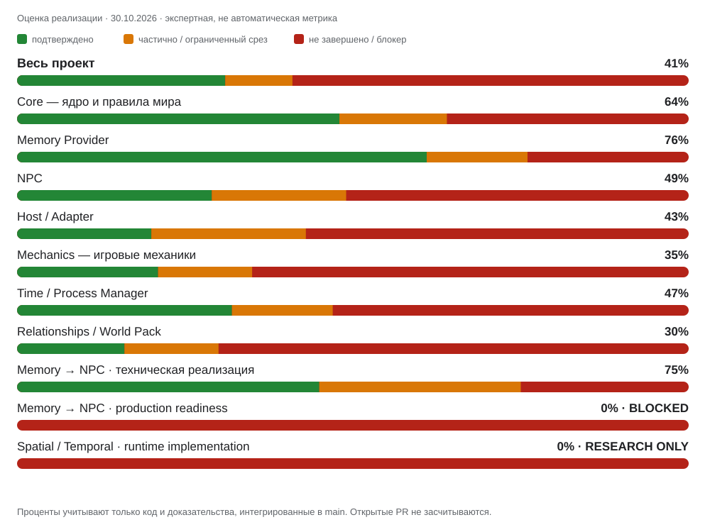

# «Логический движ»

**World Simulation Engine** — универсальный движок длительной ролевой симуляции. Он хранит авторитетное состояние мира, обрабатывает причинно связанные изменения, управляет игровым временем и длительными процессами, поддерживает автономию NPC и передаёт подтверждённые результаты в интерфейс через адаптеры.

Проект разделяет три уровня: **замысел** (цели и возможные события), **симуляцию** (то, что действительно произошло) и **повествование** (описание подтверждённых результатов, не меняющее каноническое состояние само по себе).

## Прогресс проекта



<sub>Снимок от 30.10.2026. Проценты — экспертная оценка реализации, не автоматическая метрика. Учитываются только код и доказательства, интегрированные в `main`; открытые PR и feature-ветки не засчитываются. Spatial / Temporal показан отдельно как исследовательское направление без runtime-реализации и не включён в общий процент. Это не оценка production readiness.</sub>

| Направление | Оценка на 30.10.2026 |
|---|---:|
| **Весь проект** | **41%** |
| Core | 64% |
| Memory Provider | 76% |
| NPC | 49% |
| Host / Adapter | 43% |
| Mechanics | 35% |
| Time / Process Manager | 47% |
| Relationships / World Pack | 30% |
| Memory → NPC — техническая реализация | 75% |
| Memory → NPC — production readiness | **0% · BLOCKED** |
| Spatial / Temporal — runtime | **0% · RESEARCH ONLY** |

## Архитектура

- **Core** — каноническое состояние, события, факты, причинность и проверка изменений.
- **Mechanics** — подключаемые правила и механики через контролируемые предложения изменений.
- **Time** — игровое время, временные операции и триггеры.
- **Process Manager** — длительные процессы, задачи и планы.
- **NPC** — автономные участники мира и границы их знаний.
- **Relationships** — состояние и динамика отношений.
- **Memory Provider** — хранение и жизненный цикл памяти.
- **Host / Adapter** — интеграция с SillyTavern и другими интерфейсами.
- **World Pack** — специфика конкретного мира без изменения универсального ядра.

## Основные принципы

- Движок — источник авторитетного состояния; модель предлагает действия, движок проверяет их до фиксации.
- Знания персонажей имеют источник и путь получения. Знание рассказчика не становится знанием NPC автоматически.
- Игровое время изменяется явными операциями.
- Поиск по векторному архиву помогает находить контекст, но не заменяет авторитетное состояние.
- Открытый PR, архитектурный документ или тест отдельного блока не доказывают сквозную готовность.

## Текущий статус

В репозитории находится развивающийся прототип на **Node.js + SQLite** с HTTP API и отдельными runtime-компонентами. Это ещё не завершённая автономная симуляция и не production-ready интеграция с SillyTavern.

**Memory → NPC остаётся DISABLED / FAIL-CLOSED для production.** Главный интеграционный gate — [issue #264](https://github.com/necromorphic/Logic-Engine/issues/264). Общий реестр блоков и зависимостей — [портфельный трекер #252](https://github.com/necromorphic/Logic-Engine/issues/252).

## Быстрый старт

Требуется Node.js **22.13+**.

```bash
npm install
npm start
```

Настройки окружения и ограничения запуска описаны в [руководстве по минимальному runtime](docs/20-minimal-runtime.md); пример переменных — в `.env.example`.

Запуск тестов:

```bash
npm test
```

## Документация

- [Архитектурная карта](docs/00-architecture-baseline.md)
- [Модель канонического состояния](docs/01-core-domain-model.md)
- [Жизненный цикл Turn / WorldEvent / Delivery](docs/02-turn-event-delivery-lifecycle.md)
- [Хранение и persistence](docs/03-storage-and-persistence-contract.md)
- [Формат World Pack](docs/04-world-pack-format.md)
- [Причинность и rollback](docs/18-rollback-and-causality.md)
- [Автономия NPC и Process Manager](docs/06-npc-autonomy-and-process-manager.md)
- [Границы знаний и повествования](docs/07-knowledge-and-narrative-boundaries.md)
- [Универсальная система механик](docs/25-universal-mechanics-system.md)
- [Контракт адаптера SillyTavern](docs/13-sillytavern-adapter-contract.md)
- [Запуск и ограничения runtime](docs/20-minimal-runtime.md)

Подробные аудиты, планы интеграции и тестовые доказательства находятся в `docs/` и GitHub Issues. README остаётся обзорной страницей проекта.
