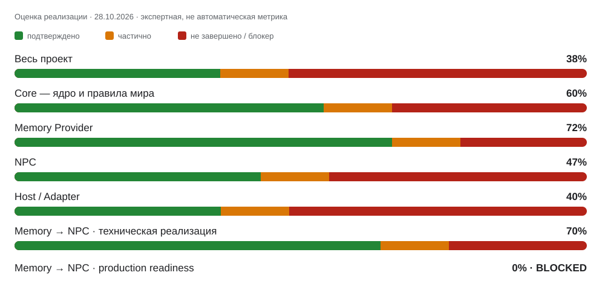

# World Simulation Engine — «Логический движ»

**«Логический движ» — проект универсального движка длительной ролевой симуляции.** Цель — хранить авторитетное состояние мира, рассчитывать причинно связанные изменения и игровое время, поддерживать автономность NPC и передавать подтверждённые результаты в повествование через адаптер SillyTavern.

> **Актуальность: 29 октября 2026 года.** Последний проверенный функциональный commit `main` — `87b452939f690a6ad76cfeb0c3e06ad040fef900` (`feat(core): trusted initial knowledge source ingestion`, 28 октября); последний проверенный HEAD `main` — `b5fc27506ffda4fd6bc2e236c0463231f6c6c321` (документальное обновление README, 29 октября). После функционального merge #665 новых функциональных изменений в `main` не подтверждено. Открытые PR перечислены по актуальным head и CI; они не считаются частью `main`. Merge #665 добавил ограниченную Core-owned основу для trusted knowledge acquisition, но не включает NPC reader, prompt injection или production Memory → NPC. Количество открытых PR и веток для этой ревизии отдельно не пересчитывалось. Последний полный снимок веток — 512, это историческое значение, не текущий подсчёт. Подробности предыдущей сверки: [отчёт по веткам и консолидации PR](docs/branch-pr-consolidation-2026-10-28.md) и [полный инвентарь](docs/branch-issue-inventory-2026-10-28.md).
> Это снимок проверенных изменений и известных блокеров на указанную дату. Портфельный трекер — [issue #252](https://github.com/necromorphic/Logic-Engine/issues/252); глобальный блокер Memory → NPC — [issue #264](https://github.com/necromorphic/Logic-Engine/issues/264).
>
> **Состояние проекта:** есть исполняемый прототип с HTTP API, SQLite-журналом событий, базовыми сущностями и фактами, идемпотентностью, аудитом, ограниченным причинным откатом, реестром механик и базовым жизненным циклом предложений. Это ещё не завершённая автономная симуляция и не готовая production-интеграция с SillyTavern.
>
> **Memory → NPC: Provider blocker #3 закрыт только в пределах интегрированного Provider/Gateway среза; сквозная интеграция не готова.** PR #618 находится в `main` и добавляет accepted-head контроль Core/Provider writes, отзывов, tombstone/purge, reconciliation/readiness и восстановления с pre-dispatch gate. Это не доказывает полноту Host inventory и не разрешает production-передачу памяти NPC. Актуальные кандидаты: [#681 — Core source-version ledger на текущую архитектуру](https://github.com/necromorphic/Logic-Engine/pull/681), [#680 — Host lifecycle inventory и request-bound save capability](https://github.com/necromorphic/Logic-Engine/pull/680), [#636 — Windows Provider acceptance evidence](https://github.com/necromorphic/Logic-Engine/pull/636), [#646 — сериализация начала dispatch относительно revoke](https://github.com/necromorphic/Logic-Engine/pull/646), [#670 — Core-owned NPC knowledge reader и belief boundary](https://github.com/necromorphic/Logic-Engine/pull/670), [#595 — fail-closed generation interceptor seam](https://github.com/necromorphic/Logic-Engine/pull/595), [#664 — trusted World Pack digest](https://github.com/necromorphic/Logic-Engine/pull/664). Все они остаются открытыми review-only кандидатами, а не интегрированным кодом; production dispatch не разрешён.
>
> **Production Memory → NPC остаётся DISABLED / FAIL-CLOSED.** Provider blocker #3 закрыт на уровне реализации и тестов: если отзыв записи/запроса или потеря readiness зафиксированы до durable `DISPATCH_STARTED`, Gateway обязан выполнить ноль исходящих вызовов и не создавать запись dispatch ledger. Проверено и восстановление старой Provider DB против независимого accepted head. Но независимый remote anti-rollback для самой authority, целевые ACL/backup-restore, полнота Host inventory, окончательная привязка сериализованного тела и доказательство единственного outbound-пути в установленном SillyTavern пока не подтверждены.
>
## Оценка прогресса

> **Снимок: 28 октября 2026 года.** Проценты — ориентировочная экспертная оценка, а не автоматически измеряемая метрика. Цветная горизонтальная полоса показывает подтверждённую часть (зелёный), частично подтверждённую/незавершённую часть (оранжевый) и оставшуюся работу или блокеры (красный). Полосы непрерывные, без символов-кубиков. Учитываются изменения, уже попавшие в `main`; открытые PR и feature-ветки не считаются интегрированными.

| Направление | Оценка | Изменение к прежнему снимку |
|---|---:|---:|
| **Весь проект** | **38%** | **+3 п.п.** |
| Core — ядро и правила мира | 60% | +5 п.п. |
| Memory Provider — хранение и операции памяти | 72% | +2 п.п. |
| NPC — допуск и потребление памяти | 47% | +2 п.п. |
| Host / Adapter — связь с SillyTavern | 40% | +5 п.п. |
| Mechanics — игровые механики | 35% | без изменения |
| Time / Process Manager — время и длительные процессы | 38% | +8 п.п. |
| Relationships / World Pack — отношения и пакеты миров | 28% | +3 п.п. |
| Memory → NPC — техническая реализация | 70% | +5 п.п. |
| Memory → NPC — production readiness | **0% — BLOCKED** | без изменения |

Проценты и диаграмма — историческая оценка `main` на 28.10.2026 до merge #665. После merge `87b452939f690a6ad76cfeb0c3e06ad040fef900` оценки не пересчитывались; новые открытые PR и feature-ветки не засчитываются как интегрированные. Это оценка прогресса реализации, а не готовности production.

### Memory → NPC: что готово и что блокирует включение

Технический прогресс и разрешение на реальное использование — разные показатели. Production Memory → NPC остаётся **DISABLED / FAIL-CLOSED**.

**Изменения в основной ветке:** в `main` присутствуют контракт #527 (полный пустой результат отличается от отказа/неполноты) и PR #618 — accepted-head защита реальных Core/Provider writes, revoke, tombstone/purge, reconciliation/readiness и recovery с pre-dispatch Gateway gate. Это закрывает Provider blocker #3 на уровне кода и тестов, но не доказывает полноту Host inventory или сквозную доставку памяти конкретному NPC.

**Актуальные открытые кандидаты, не считать частью `main`, пока PR не слит:**
- [PR #640](https://github.com/necromorphic/Logic-Engine/pull/640) — исходная source-version ledger ветка, только evidence; базовая история устарела. Для дальнейшей работы использовать current-main порт #681.
- [PR #681](https://github.com/necromorphic/Logic-Engine/pull/681) — Core source-version ledger/inventory, exact HEAD `1ee9e20fc7160e028d494f7860efbfdfc2f1c3fb`: Provider blocker-3 30/30 и полный Runtime workflow, включая `npm test`, oracle 20/20, NPC boundary и trusted-acquisition lifecycle, PASS ([Provider](https://github.com/necromorphic/Logic-Engine/actions/runs/40772284591), [Runtime](https://github.com/necromorphic/Logic-Engine/actions/runs/40772284701)). Ветка основана на более старом `main` и требует свежего порта. Миграция 14 конфликтует с #670 и должна быть согласована с #664; до общего migration/reopen/rollback теста не сливать.
- [PR #632](https://github.com/necromorphic/Logic-Engine/pull/632) — закрытая без merge старая Host lifecycle validation-ветка; только evidence, не переносить её историю. Для дальнейшей работы использовать current-main порт #680.
- [PR #680](https://github.com/necromorphic/Logic-Engine/pull/680) — Host lifecycle/save-capability port, текущий HEAD `ae6bba85b8d8673a6978a2507225b0c29b861546`: все пять exact-head workflows PASS, включая Host patch checks, IndexedDB restart, Runtime suite, NPC boundary, trusted-acquisition lifecycle и pinned-source Linux/Windows route harness ([CI](https://github.com/necromorphic/Logic-Engine/actions)). Ветка ещё требует синхронизации с последним документальным HEAD `main`; CI не доказывает полный all-time Host inventory, anti-rollback, target-PC ACL/restore, sole egress или live deployment.
- [PR #636](https://github.com/necromorphic/Logic-Engine/pull/636) — Windows Memory Provider acceptance evidence.
- [PR #646](https://github.com/necromorphic/Logic-Engine/pull/646) — сериализация старта Host dispatch относительно отзыва; нужен доказанный путь от этого gate до реального final-send.
- [PR #670](https://github.com/necromorphic/Logic-Engine/pull/670) — Core-owned actor-scoped knowledge reader и belief-transition boundary поверх #665. Последний наблюдавшийся branch HEAD `0dc40599fe2827131c93289ac65425b4f8ab9e07`: Provider blocker-3 PASS; свежий полный Runtime workflow был запущен и на момент последней проверки ещё выполнялся, поэтому full Runtime PASS пока не засчитывается. Ранее найденный Windows benchmark timeout вынесен в отдельный test-only PR #682, его exact-head Runtime прошёл. Остаётся контрактный Core-вопрос: acquisition не закрепляет версию/значение факта, а reader берёт текущее значение по `fact_id` ([обсуждение #140](https://github.com/necromorphic/Logic-Engine/issues/140#issuecomment-6480878131)). Миграция #670 должна быть согласована с #681 и #664. Draft; production Memory → NPC отключён.

**Обязательные блокеры включения:**
1. Доказать полный Host inventory активных, исторических и удалённых версий переписки, включая пропущенные изменения, импорт, ветвление и восстановление.
2. Подключить доверенный verifier, который разрешает reconciliation только при доказанной полноте inventory. Сейчас отсутствие доказательства должно приводить к отказу.
3. Связать финальное сериализованное тело запроса SillyTavern с точными допущенными кандидатами памяти через один защищённый outbound-путь.
4. Provider/Gateway pre-dispatch revoke/readiness race покрыт тестами; остаётся доказать, что реальный pinned SillyTavern final-send использует именно Gateway как единственный outbound-путь, без обходного sender/retry.
5. Подтвердить на целевом развёртывании identity процесса, ACL базы и файлов WAL/SHM, а также изоляцию backup/restore.
6. Проверить фактическую интеграцию с установленным SillyTavern и сохранность данных после перезапуска; Android/Termux persistence пока не подтверждена.

Открытый PR, зелёный CI или тест на feature-ветке не равны merge, Core approval или production readiness. См. [глобальный блокер #264](https://github.com/necromorphic/Logic-Engine/issues/264), [Core Memory/NPC gate #140](https://github.com/necromorphic/Logic-Engine/issues/140) и [портфельный трекер #252](https://github.com/necromorphic/Logic-Engine/issues/252).

## First Release Readiness — критерии первой рабочей версии

Первая рабочая версия не требует, чтобы **каждый запланированный блок** был завершён. Она требует, чтобы был чётко ограничен набор функций релиза и каждый обязательный критерий этого набора подтверждён кодом, тестами и интеграционными доказательствами.

- [ ] **Объём релиза зафиксирован:** перечислены функции, которые входят в первую версию, и явно исключённые функции.
- [ ] **Изменения интегрированы:** нужный релизу код находится в `main`; feature-ветки и открытые PR не считаются готовыми.
- [ ] **Тесты текущего `main` проходят:** результаты относятся к точному проверяемому commit.
- [ ] **Сквозной сценарий работает:** реальный запрос проходит через поддерживаемый Host/Adapter → Core путь и возвращает ожидаемый результат.
- [ ] **Данные переживают перезапуск:** сохранение, восстановление и обработка неполной/устаревшей информации проверены на целевой конфигурации.
- [ ] **Ошибки закрываются безопасно:** отказ, неполные данные, устаревшая версия или сбой не превращаются в разрешение на доступ.
- [ ] **Безопасность проверена:** права доступа, удаление/отзыв, резервные копии и восстановление проверены для функций, входящих в релиз.
- [ ] **Memory → NPC gate закрыт**, если первая версия должна передавать память NPC. До этого Memory → NPC остаётся отключённым.
- [ ] **Инструкция запуска и отката готова:** понятно, как запустить версию, проверить состояние и безопасно вернуться назад.

Релиз можно объявить готовым только после проверки каждого обязательного пункта и фиксации доказательств. Процент проекта не заменяет этот чек-лист. Если первая версия выпускается без Memory → NPC, это должно быть явно указано в её объёме; сам Memory → NPC gate при этом остаётся закрытым.

## Основной принцип

**Замысел ≠ происходящее ≠ рассказанное.**

1. Сюжетные арки описывают предполагаемые цели, опорные точки и допустимые варианты.
2. Симуляция вычисляет, что фактически произошло, на основании состояния, правил мира, действий, знаний и причин.
3. Повествование отражает подтверждённые результаты и не создаёт канонические факты само по себе.

## Непереговорные требования

- Игровое время заморожено, пока игрок не совершает действие и не запрашивает продвижение времени.
- Движок — источник авторитетного состояния; языковая модель предлагает действия и формулирует повествование, но предложения валидируются до коммита.
- NPC должны автономно взаимодействовать друг с другом и миром, менять планы, формировать союзы и конфликты, ошибаться, сомневаться и пересматривать убеждения. Это целевые требования, а не заявление о завершённой реализации.
- Знания должны иметь происхождение и путь получения; секреты не распространяются между персонажами без допустимого источника и доставки.
- Поддерживаются как заданные сюжетные арки, так и свободная симуляция с автономными событиями мира.
- Сохранённые задачи, планы и длительные процессы должны продолжаться независимо от того, помнит ли о них текущий контекст модели.
- Откат должен устранять зависимые последствия, сохраняя независимые ветви. Полная семантика альтернативных независимых причин пока не подтверждена.
- Векторный архив — средство поиска контекста, а не авторитетная база фактов. **Существующую векторизацию и Ollama remote-store patch не переписывать.**
- SillyTavern на Android/Termux остаётся RP-интерфейсом; Logic-Engine и его обработка должны работать на компьютере. Связь — по LAN, когда доступно, или через мост. Реальные хуки и надёжность интеграции необходимо проверять.
- Общее ядро не навязывает миру чужие механики. Специфические правила принадлежат отдельному World Pack; неизвестные механики явно маркируются.

## Текущая граница реализации

| Область | Статус на 29.10.2026 |
|---|---|
| HTTP API, SQLite-журнал, проекции, базовые сущности/факты, аудит и идемпотентность | Есть в прототипе; гарантия ограничена кодом и тестами текущей версии |
| Причинный откат и перестроение проекций | Частично реализованы; полная семантика независимых альтернативных причин не подтверждена |
| Механики: bounded effect-intent translation → proposal → approval → canonical commit | Ограниченный перевод трёх intent kinds и интеграция с существующим ProposalService находятся в `main` через PR #280; это не полноценный mechanic executor и не production approval |
| Recalculation oracle / executor | Изолированный oracle и его тесты находятся в `main`; oracle не пересчитывает canonical world state. Полный dependency-aware executor, policy-freshness gate и production enablement не подтверждены |
| Rollback transaction regression | Транзакционная регрессия присутствует в `main`; сама по себе не закрывает полную policy-freshness интеграцию |
| Типизированные отношения | Ограниченный admin-only transition есть; полноценный NPC-facing authorized read и причинная семантика не завершены |
| Actor bindings / authorized read | Частичные инфраструктурные примитивы есть; полной модели приобретения знаний, убеждений, доставки и секретов нет |
| Host → Provider authoritative inventory | **BLOCKED / NON_READY**: полнота активных и исторических/удалённых версий и обнаружение пропущенных изменений не доказаны |
| Реальный Host → Provider → Core → NPC путь | **NOT PROVEN**: Provider-local tests не доказывают Host inventory, реальную интеграцию или Android/Termux persistence |
| Revocation прямо перед disclosure | **BLOCKED / NOT PROVEN** на реальном пути от candidate assembly до финального serializer/outbound transport |
| Автономные NPC, долговременные процессы, StoryBeat, полный World Pack loader, проверенный ST-адаптер | Не реализованы как завершённая end-to-end система |

**Правило доказательств:** архитектурный документ или открытый PR не является реализованной возможностью. Прохождение CI одной ветки не означает merge, интеграционную готовность или разрешение на production. Различать source-inspected, fixture-tested, runtime-observed и real Android/Termux-tested результаты.

**Безопасностная граница:** согласованный SQLite snapshot не является разрешением на доступ. Сырые сущности, факты и метаданные событий нельзя напрямую передавать NPC, повествователю или игроку. Проверки авторизации, версии, lineage, inventory и revocation должны быть доказаны на фактическом пути раскрытия. Пока необходимые gates не пройдены, Memory → NPC остаётся выключенным.

## Активные сквозные блокеры

- **[Issue #264 — Host → Provider evidence and production-readiness gate](https://github.com/necromorphic/Logic-Engine/issues/264):** единый пакет доказательств, Host inventory, Provider reconciliation, точный disclosure boundary и список минимальных решений Core. Не создавать параллельные mapping-документы.
- **[Issue #258 — Host/Adapter lifecycle evidence](https://github.com/necromorphic/Logic-Engine/issues/258):** проверить идентичность и lifecycle на закреплённой версии SillyTavern `1.19.0-1-g06bde939f` (SHA `06bde939fb1e9c4c8d8641d810f0a916b5bce127`). Пока нет доказанного полного inventory; кандидат patch не считается применённым или runtime-проверенным.
- **[Issue #181 — Memory Provider](https://github.com/necromorphic/Logic-Engine/issues/181):** Provider blocker #3 интегрирован в `main` через PR #618; Host inventory, независимый anti-rollback authority и production deployment controls остаются вне этого закрытого среза. Приёмка пункта B зафиксирована в [`docs/memory-provider-acceptance-b-2026-10-28.md`](docs/memory-provider-acceptance-b-2026-10-28.md): Core запрещает долговременное хранение исходного текста SillyTavern, поэтому raw capture/read/active-selection остаются fail-closed; это не блокер ожидания нового решения. PR #636 собирает дополнительное Windows acceptance evidence, но пока не слит.
- **[Issue #226 — Mechanics acceptance](https://github.com/necromorphic/Logic-Engine/issues/226):** остаётся блокер policy-freshness — авторитетный источник политики должен быть проверен при approval/commit, включая end-to-end rotation версии политики.
- **[Issue #252 — Portfolio manager](https://github.com/necromorphic/Logic-Engine/issues/252):** общий реестр активных блоков, зависимостей, доказательств, владельцев и следующих действий.

Не добавлять новые persistent fields, API, schemas, stores, journals, cursors, outboxes, lifecycle hooks или production wiring в Host/Provider path до второго явного одобрения Core на конкретный diff. Не менять существующий патч векторизации.

## Документы

### Архитектурные контракты
- `docs/00-architecture-baseline.md` — карта архитектуры и границы ответственности.
- `docs/01-core-domain-model.md` — универсальные типы канонического состояния.
- `docs/02-turn-event-delivery-lifecycle.md` — жизненные циклы Turn, WorldEvent и Delivery, идемпотентность и границы коммита.
- `docs/03-storage-and-persistence-contract.md` — канонические данные, производные индексы, транзакции, изоляция и восстановление.
- `docs/04-world-pack-format.md` — формат и правила декларативного World Pack.
- `docs/05-causal-rollback-algorithm.md` — алгоритм построения RollbackPlan и тесты RB-001–RB-014.
- `docs/06-npc-autonomy-and-process-manager.md` — автономные цели/планы/задачи и параллельные процессы.
- `docs/07-knowledge-and-narrative-boundaries.md` — знания, приватность, повествование и подтверждение доставки.
- `docs/56-context-aware-interpretation-of-communicative-intent.md` — контекстная интерпретация коммуникативного намерения, неопределённость, provenance, пересмотр и отзыв гипотез; архитектурное предложение без runtime-реализации.
- `docs/08-stage1-acceptance-plan.md` — критерии завершения Stage 1, профили миров и матрица тестирования.
- `docs/09-reuse-and-attribution-register.md` — реестр внешних проектов, лицензий и правил переноса кода.
- `docs/10-open-decisions.md` — блокирующие и отложенные решения.
- `docs/11-operations-and-recovery.md` — локальный runtime, безопасность, резервное копирование и восстановление.
- `docs/12-stage-roadmap.md` — этапы реализации и критерии перехода между ними.
- `docs/13-sillytavern-adapter-contract.md` — контракт адаптера SillyTavern и граница векторизации.
- `docs/17-world-agnostic-design-stage1.3.md` — критерий универсальности и граница World Pack.
- `docs/18-rollback-and-causality.md` — требуемая семантика причинного отката.
- `docs/19-reuse-audit-existing-projects.md` — анализ готовых проектов и карта адаптации.
- `docs/21-stage1-causality-contract.md` — гарантии и ограничения текущей причинности, контракт будущей верификации.
- `docs/25-universal-mechanics-system.md` — архитектура универсальной системы механик.
- `docs/26-mechanics-contracts.md` — контракты шаблонов/экземпляров/модулей и текущая граница реализации.
- `docs/32-mechanic-effect-translator-contract.md` — фактическая граница ограниченного translator (только `create_entity`, `update_attribute`, `assert_fact`).
- `docs/33-mechanic-intent-proposal-boundary.md` — путь `effect_intents` через ProposalService и канонический commit.
- `docs/34-mechanics-oracle-reconciliation.md` — что реально вошло в Mechanics/Core интеграцию и чего oracle не доказывает.
- `docs/17-time-process-state-machine-proposal.md` — согласование Time scheduler с Process Manager runtime.
- `docs/22-process-manager-runtime.md` — текущий runtime-контракт долговременных процессов.
- `docs/57-core-evaluation-recalculation-boundary.md` — граница логического ядра: интерпретация, оценка, конфликты, commit, пересчёт производного состояния и авторизованная публикация; архитектурное предложение.

### Исполняемый прототип
- `package.json` — Node.js runtime scripts.
- `src/core/` — ошибки и ограниченный декларативный evaluator.
- `src/application/engine.js` — прикладные команды и проверка входных данных.
- `src/storage/sqlite-store.js` — журнал событий, проекции состояния, аудит и прототип причинного отката.
- `src/api/server.js` — независимый от интерфейса HTTP API.
- `tests/` — контрактные тесты.
- `docs/20-minimal-runtime.md` — запуск, endpoints и ограничения текущей реализации.

Запуск требует Node.js 22.13+, `ENGINE_API_TOKEN` (не менее 16 символов) и явный абсолютный `LOGIC_ENGINE_COORDINATOR_DB_PATH`, указывающий на отдельный SQLite-файл общего координатора; он должен быть одинаковым у Core и всех подключённых участников и не должен совпадать с `ENGINE_DB_PATH`. `ENGINE_HOST_VERSION_LEDGER_DB_PATH` задаёт отдельный digest-only журнал Host-версий (по умолчанию `./data/logic-engine-host-versions.sqlite`). Его API принимает только идентификаторы версий и SHA-256 digest, не текст сообщений. Пока trusted Host inventory verifier не подключён, reconciliation остаётся fail-closed и Memory→NPC не включается. Координатор сериализует только участвующие в нём записи; он не блокирует сторонний процесс, который напрямую открывает Core DB, поэтому OS-level single-writer isolation остаётся обязательным для production. Для создания proposals настрой `ENGINE_ADAPTER_TOKENS` как JSON-объект идентификаторов адаптеров и отдельных секретов; для регистрации механик/модулей задай отдельный `ENGINE_ADMIN_TOKEN`. `ENGINE_APPROVAL_TOKEN` включает отдельный gate подтверждения. Пример переменных находится в `.env.example`. `npm test` запускает текущие тесты. Встроенный `node:sqlite` в используемых версиях Node может помечаться как experimental.

### Решения и схемы
- `docs/decisions/ADR-0006-rollback-semantics.md` — предлагаемая семантика отката.
- `docs/decisions/ADR-0007-world-pack-boundary.md` — предлагаемая граница ядра и World Pack.
- `schemas/world-pack-manifest.schema.json` — начальная JSON Schema манифеста World Pack.
- `schemas/declarative-rule.schema.json` — ограниченный формат условий и эффектов.
- `schemas/rollback-plan.schema.json` — структурный контракт плана отката.
- `schemas/effect-proposal.schema.json` — контракт предложения изменений до валидации и коммита.
- `schemas/mechanic-template.schema.json` — неизменяемый версионируемый шаблон механики.
- `schemas/mechanic-instance.schema.json` — экземпляр механики, изолированный внутри мира.
- `schemas/rule-module-manifest.schema.json` — контракт allowlist-реестра версионированных модулей.

### Примеры и независимое ревью
- `examples/world-packs/biological-world.json` — тестовый профиль с биологическими сущностями.
- `examples/world-packs/magic-world.json` — тестовый профиль с неизвестными магическими механиками.
- `examples/world-packs/digital-world.json` — цифровой мир без обязательных биологических полей.
- `AI_REVIEW_BRIEF.md` — задание для независимого архитектурного аудита языковыми моделями.

## Статус и порядок работы

Прототип пока не равен полноценному движку и не должен использоваться как production-система. Причинные ссылки задаются вызывающей стороной и не проверяются на полноту; модель знаний, автономные процессы, полный World Pack loader и проверенный SillyTavern-адаптер не завершены. Возможность считается реализованной только после проверки кода, актуального коммита и соответствующих тестов.

Текущая экспериментальная реализация использует JavaScript/Node.js + SQLite. Архитектура API не привязана к SillyTavern; конкретные хуки ST-адаптера необходимо проверять отдельно.
