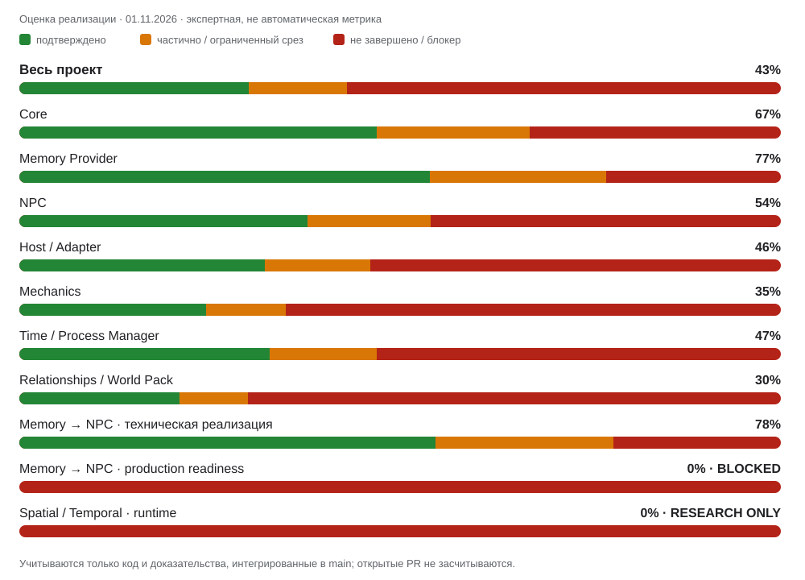

# «Логический движ»

**World Simulation Engine** — универсальный движок длительной ролевой симуляции. Он хранит авторитетное состояние мира, обрабатывает причинно связанные изменения, управляет игровым временем и длительными процессами, поддерживает автономию NPC и передаёт подтверждённые результаты через адаптеры.

Проект разделяет три уровня: **замысел** (цели и возможные события), **симуляцию** (то, что действительно произошло) и **повествование** (описание подтверждённых результатов, не меняющее каноническое состояние само по себе).

## Прогресс проекта



<sub>Снимок от 01.11.2026. Проценты — экспертная оценка реализации, а не автоматическая метрика. Учитываются только код и доказательства, интегрированные в `main`; открытые PR и feature-ветки не засчитываются. Spatial / Temporal показан отдельно как исследовательское направление без runtime-реализации. Это не оценка production readiness.</sub>

| Направление | Оценка на 01.11.2026 |
|---|---:|
| **Весь проект** | **43%** |
| Core | 67% |
| Memory Provider | 77% |
| NPC | 54% |
| Host / Adapter | 46% |
| Mechanics | 35% |
| Time / Process Manager | 47% |
| Relationships / World Pack | 30% |
| Memory → NPC — техническая реализация | 78% |
| Memory → NPC — production readiness | **0% · BLOCKED** |
| Spatial / Temporal — runtime | **0% · RESEARCH ONLY** |

## Архитектура

- **Core** — каноническое состояние, события, факты, причинность, авторизация и проверка изменений.
- **Mechanics** — подключаемые правила и механики через контролируемые предложения изменений.
- **Time** — игровое время, временные операции и триггеры.
- **Process Manager** — длительные процессы, задачи и планы.
- **NPC** — автономные участники мира, субъектные знания и убеждения.
- **Relationships** — состояние и динамика отношений.
- **Memory Provider** — хранение, версии, происхождение и жизненный цикл памяти.
- **Host / Adapter** — интеграция с SillyTavern и другими интерфейсами.
- **World Pack** — специфика конкретного мира без изменения универсального ядра.

## Текущий статус — 01.11.2026

Репозиторий содержит развивающийся прототип на **Node.js 22.13+ и SQLite** с HTTP API, каноническим хранилищем, временными операциями, механиками и отдельными runtime-компонентами. Это ещё не завершённая автономная симуляция и не production-ready интеграция с SillyTavern.

### Что уже интегрировано в `main`

- Core runtime поддерживает actor-bound NPC knowledge reads и belief transitions как внутренние операции. Проверки привязывают субъект к Core actor binding; чтение и изменение убеждений разделены.
- Core проверяет авторизованные поля и происхождение trusted initial/imported источников; для импортируемого файла проверяется точная файловая идентичность.
- Host version ledger хранит digest-only идентификаторы версий сообщений и lineage, не сохраняя исходный текст. Неполный или неподтверждённый inventory не может установить Host readiness; неполный доверенный снимок сбрасывает ранее установленную READY-состояние.
- Provider/Host доказательства остаются раздельными: Host message/version metadata не становится автоматически семантической записью Memory Provider.
- Для SQLite и файловых границ добавляются проверки идентичности, устойчивости к ссылкам и воспроизведения состояния; эти меры не следует считать доказательством полной защиты от всех TOCTOU-атак.

### Что остаётся ограниченным или заблокированным

- **Memory → NPC: DISABLED / FAIL-CLOSED для production.** Наличие внутренних Core reader/belief операций не означает, что Memory Provider подключён к безопасному сквозному пути выдачи контекста NPC.
- Не завершены совместная Core/Provider авторизация на реальной композиции, проверка source lineage/version и повторная проверка прав после чтения для всех сценариев.
- Host inventory для SillyTavern пока не доказывает полный жизненный цикл данных: все корни, операции, изменения, удаление, импорт/экспорт, восстановление, миграции, crash/restart и durable reconciliation.
- Защищённый final-send путь через все поддерживаемые SillyTavern generation backends не реализован. Нельзя заявлять zero-egress или production disclosure guarantee.
- Открытые PR с Host, Core и SillyTavern connector изменениями являются кандидатами на review, а не частью функциональности `main`.

Главный интеграционный gate Memory → NPC — [issue #264](https://github.com/necromorphic/Logic-Engine/issues/264). Общий реестр блоков и зависимостей — [портфельный трекер #252](https://github.com/necromorphic/Logic-Engine/issues/252).

## Основные принципы

- Движок — источник авторитетного состояния; модель предлагает действия, движок проверяет их до фиксации.
- Знания персонажей имеют источник и путь получения. Знание рассказчика не становится знанием NPC автоматически.
- Игровое время изменяется явными операциями.
- Поиск по векторному архиву помогает находить контекст, но не заменяет авторитетное состояние и проверку доступа.
- Чтение, раскрытие модели, отправка, получение и усвоение знания — разные стадии с отдельными доказательствами.
- Открытый PR, архитектурный документ или тест отдельного блока не доказывают сквозную готовность.

## Быстрый старт

Требуется Node.js **22.13+**.

```bash
npm install
npm start
```

Для запуска runtime требуется deployment-controlled World Pack catalog; обязательные переменные и ограничения описаны в [руководстве по минимальному runtime](docs/20-minimal-runtime.md), пример переменных — в `.env.example`.

Для read-only проверки deployment manifest используйте `LOGIC_ENGINE_DEPLOYMENT_MANIFEST` и `LOGIC_ENGINE_DEPLOYMENT_ROOT`, затем `npm run deployment:verify`. Команда формирует машинно-читаемый отчёт и не меняет ACL, службы, аккаунты, базы или резервные копии.

Запуск тестов:

```bash
npm test
```

## Документация

- [Архитектурная карта](docs/00-architecture-baseline.md)
- [Модель канонического состояния](docs/01-core-domain-model.md)
- [Жизненный цикл Turn / WorldEvent / Delivery](docs/02-turn-event-delivery-lifecycle.md)
- [Хранение и persistence](docs/03-storage-and-persistence-contract.md)
- [Формат World Pack](docs/04-world-pack-format.md)
- [Причинность и rollback](docs/18-rollback-and-causality.md)
- [Автономия NPC и Process Manager](docs/06-npc-autonomy-and-process-manager.md)
- [Границы знаний и повествования](docs/07-knowledge-and-narrative-boundaries.md)
- [Универсальная система механик](docs/25-universal-mechanics-system.md)
- [Контракт адаптера SillyTavern](docs/13-sillytavern-adapter-contract.md)
- [Запуск и ограничения runtime](docs/20-minimal-runtime.md)
- [Универсальная модель Deployment/Security](docs/95-universal-deployment-security-architecture.md)
- [Deployment contracts v1 и текущая реализация](docs/96-deployment-contracts-v1.md)
- [Установка интеграционного кандидата в существующую SillyTavern 1.19.0](docs/109-install-existing-sillytavern-candidate.md)

Подробные аудиты, планы интеграции и тестовые доказательства находятся в `docs/` и GitHub Issues. README — обзорная страница; нормативные контракты и release gates определяются профильной документацией и принятыми решениями.
